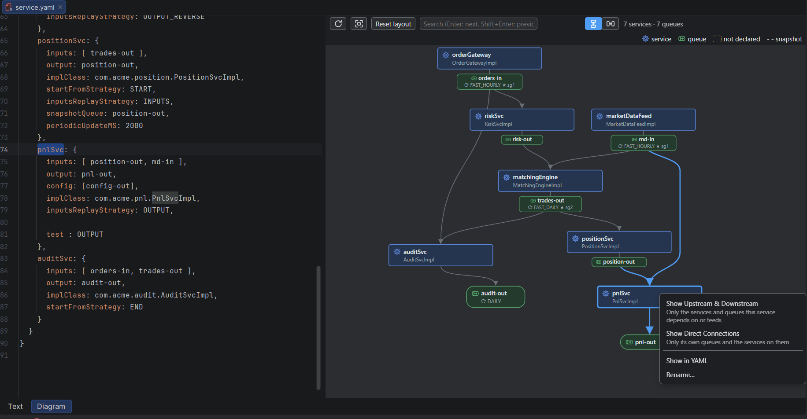

#  Chronicle Services Diagram

An IntelliJ IDEA plugin that adds a **Diagram** tab to Chronicle Services `services.yaml` files, next to the usual **Text** tab at the bottom of the editor. The diagram shows the services and the queues they read and write, and you can edit the YAML from it.



## Features

- **YAML beside the diagram:** the Diagram tab is split, with the editable YAML on the left and the diagram on the right. Both show the same document, so a change on either side appears in the other right away. Selecting a node scrolls the YAML to its declaration. Drag the divider to resize; the position is remembered.
- **Diagram of services and queues:** services are boxes. Each queue is a labelled arrow from the service that writes it to the services that read it, and its tag shows the roll cycle and master. A queue with no writer or no reader is a small pill. The flow runs *Top to bottom* by default; a toolbar toggle switches it to *Left to right*, and the IDE remembers the choice. The layout keeps arrow crossings to a minimum.
- **Drag to arrange:** drag services, queue pills and queue tags, and their arrows follow. A dragged tag stays attached to the service that writes it, and the arrows run through it to the readers. Moved nodes keep their place through YAML edits and renames, and each layout and focus view keeps its own arrangement. *Reset layout* puts the current view back. Positions are kept until the file is closed.
- **Fills the space:** the diagram fits its area and re-fits when you maximize or resize the window or drag the divider. Panning or zooming yourself switches this off, and the view keeps its centre on resize. *Fit* switches it back on.
- **Rename from the diagram:** double-click a node. Renaming a queue updates its declaration and every service `inputs`, `output` and `snapshotQueue` that refers to it, as one undoable step. Make other changes in the YAML beside the diagram.
- **Search:** type in the search box (Ctrl+F) to highlight every node whose name, properties or builder settings match. Enter jumps to the next match and Shift+Enter to the previous one. Each jump zooms in on the match and shows its YAML. Esc clears the search.
- **Focus on part of a large diagram:** right-click a service or queue.
  - *Show Upstream & Downstream* keeps only what feeds it, all the way back, and what it feeds, all the way forward.
  - *Show Direct Connections* keeps only its own queues and the services on them.
  - The toolbar shows what you're focused on. *Show All*, or Esc, brings everything back.
- **Problems are marked:** a queue that a service uses but the `queues` section doesn't declare is drawn dashed, and so is a `master` that isn't one of the replicate sets.
- **Jump to the YAML:** click a node to scroll the YAML to its declaration, or Ctrl+click to also move the cursor there.

The tab appears for files named `service.yaml` or `services.yaml`, and for any `.yaml`/`.yml` file whose first 4 KB contain `!ChronicleServicesCfg`.

## Expected format

```yaml
!ChronicleServicesCfg {
  queues: {
    orders-in: {
      path: data/orders-in,
      builder: !SingleChronicleQueueBuilder { rollCycle: !RollCycles FAST_HOURLY, replicateSets: [ sg1, sg2 ], master: sg1 }
    },
    trades-out: { path: data/trades-out }
  },
  services: {
    matchingEngine: { inputs: [ orders-in ], output: trades-out, implClass: com.acme.MatchingEngineImpl }
  }
}
```

Block-style YAML works too. A full example is in [src/test/resources/samples/services.yaml](src/test/resources/samples/services.yaml).

## Requirements

IntelliJ IDEA 2021.3 or newer, with the bundled YAML plugin and the embedded browser (JCEF). Since 2026.2 the browser is the "Web Browser (JCEF)" plugin.

## Building

Gradle must run on JDK 21 or newer. The plugin itself is compiled to Java 11 bytecode.

```bash
./gradlew buildPlugin    # plugin zip in build/distributions/
./gradlew test
./gradlew runIde         # sandbox IDE with the plugin installed
./gradlew verifyPlugin   # check compatibility with IDEA 2021.3 to 2026.2
```

## License

Free to use under the [MIT License](LICENSE). Copyright (c) 2026 Dushmantha Bandaranayake.
